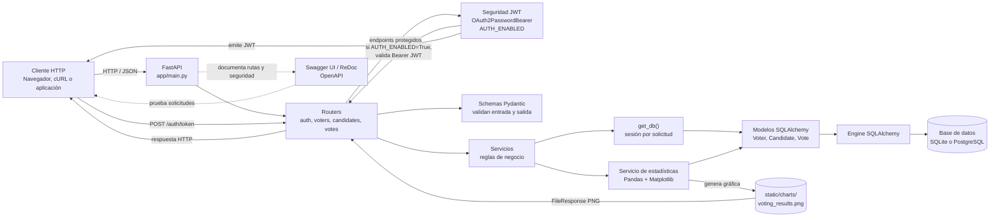
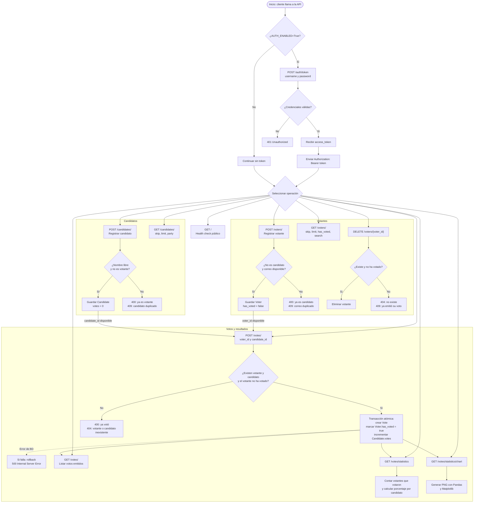

# Arquitectura y flujo de la API de votaciones

Este documento muestra cómo una solicitud atraviesa los componentes de la API y cómo se relacionan los endpoints para registrar personas, emitir votos y consultar resultados.

## Interacción entre componentes

La API separa el transporte HTTP, las reglas de negocio y el acceso a datos. Las solicitudes llegan directamente a FastAPI, sin middleware de validación del host. Los routers reciben las solicitudes; los servicios aplican validaciones y operaciones; los modelos SQLAlchemy representan los registros persistidos.

### Qué hace cada capa

| Componente | Responsabilidad |
|---|---|
| `main.py` | Crea la aplicación, registra routers y configura el esquema OpenAPI. |
| Entrada HTTP | FastAPI enruta las solicitudes directamente; no hay middleware de validación del host configurado en la aplicación. |
| `routers/` | Expone los endpoints HTTP y coordina dependencias, schemas y servicios. |
| `auth/security.py` | Emite y valida JWT. Con `AUTH_ENABLED=True`, los endpoints de votantes, candidatos y votos requieren `Authorization: Bearer <token>`. |
| `schemas/` | Valida los datos de las solicitudes y define las respuestas de la API. |
| `services/` | Aplica reglas de negocio, consultas, transacciones y generación de resultados. |
| `database.py` y `models/` | Proveen sesiones SQLAlchemy y representan votantes, candidatos y votos en la base de datos. |
| `stats_service.py` | Calcula porcentajes y genera la imagen PNG con Pandas y Matplotlib. |

## Flujo de funcionalidades y endpoints

Los endpoints de candidatos y votantes preparan los datos necesarios para emitir votos. Cada voto requiere un votante y un candidato previamente registrados. Los endpoints de listado, estadísticas y gráfica consultan la información guardada.

### Secuencia habitual

1. Si JWT está activo, obtener un token con `POST /auth/token` y enviarlo como `Authorization: Bearer <access_token>`.
2. Registrar un candidato con `POST /candidates/` y un votante con `POST /voters/`. La validación cruzada impide que una misma persona figure en ambos registros.
3. Emitir el voto con `POST /votes/`, enviando los identificadores del votante y del candidato. La operación marca al votante como participante e incrementa el conteo del candidato en una sola transacción.
4. Consultar los votos con `GET /votes/`, los porcentajes con `GET /votes/statistics` o la imagen con `GET /votes/statistics/chart`.

Los endpoints protegidos rechazan una solicitud sin token válido con `401` cuando `AUTH_ENABLED=True`. `POST /auth/token` y `GET /` permanecen públicos.
